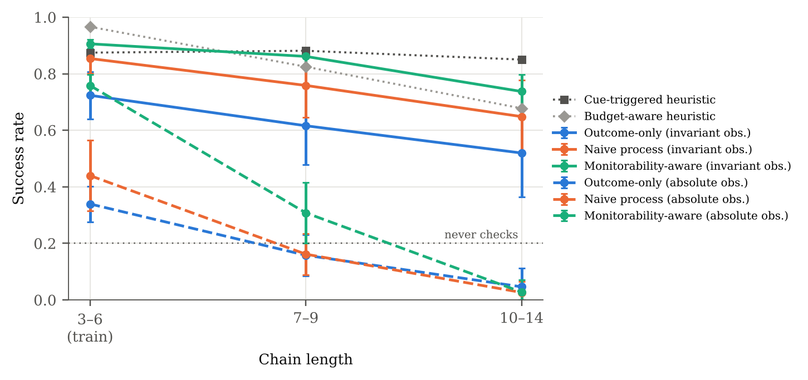

# Learning when to verify under a budget

[](https://github.com/raj200501/UltraRL/actions/workflows/ci.yml)
[](paper/main.pdf)
[](LICENSE)

Raj Kashikar · [paper (PDF)](paper/main.pdf)

> **In one sentence:** in an exact testbed for budgeted self-verification, a small RL agent's checking generalizes to longer problems only if its observations mean the same thing at every length, and its habit of catching faults without fixing them disappears once the observation records whether a fix is still pending.
>
> - **Representation:** with length-dependent features every reward falls below never-checking on long chains; length-invariant features recover most of the performance.
> - **Missing state:** agents under every reward catch faults and then fail to repair them; one bit saying "a caught fault is still open", or a window of the last 3 actions, removes this.
> - **Process rewards:** paying for informative checks makes agents find checking sooner and lose it less (85% vs 21% of late checkpoints collapse); a step-correctness bonus, closer to a process reward model, helps less, in proportion to its size.

Reasoning models increasingly check and revise their own steps. This project studies a narrow version of that behaviour that can be measured exactly: *when an agent has a fixed budget, does it learn which steps are worth checking, and does what it learns transfer to longer problems?*

**The setup.** An agent executes an arithmetic chain that may contain one silent fault. It sees a noisy one-bit "this step looks suspicious" cue and divides a fixed budget between four actions:

- `THINK`: execute the next step;
- `VERIFY`: exactly check the last step;
- `REVISE`: undo the last step;
- `COMMIT`: end the episode.

An episode succeeds if the agent commits after executing every step with the correct value. Everything is exact: where every fault is, whether it was caught, whether it was repaired, and which steps were checked.

**The rewards.** Agents are trained with one of three rewards:

- *outcome-only*: success or failure, plus a small per-action cost;
- *naive process*: adds small bonuses for correct steps and for first-time informative checks;
- *monitorability-aware*: the name used in this project's first version for a reward that pays for informative checks, especially checks of cued steps, and penalises long unchecked stretches (a penalty that any check closing the stretch refunds).

The monitorability-aware reward is a toy proxy for keeping a trajectory locally diagnosable. There is no monitor in the testbed.

**The observations.** The agent sees only local information, through one of two main encoders:

- *absolute* (the first version's encoder): position and depth as fractions of a fixed maximum, the budget as a fraction of the total, slack scaled by the total budget, and the unchecked stretch scaled by a fixed constant, so the same situation looks different on a longer chain;
- *invariant*: whether it is at the start or the end, the clipped budget slack, the clipped unchecked stretch, the cue, whether it just undid a step, and the last check result, so the same situation looks the same at every length.

Neither records whether a caught fault has been repaired. One follow-up adds that bit; others add the last 8 or the last 3 actions and check results instead.

<p align="center"><br><em>Success by chain length, checkpoints selected on training lengths; error bars are 95% t-intervals over 10 seeds; solid and dashed lines are learned agents with the invariant and absolute encoders, dotted and dash-dotted lines are reference policies.</em></p>

## Findings

- **Setup:** 10 seeds per condition, Double DQN agents with about 5k parameters (7.6k with the 8-action history input), chains up to 2.3× longer than in training.
- **Statistics:** 95% Student-t intervals over seeds. Comparisons are paired by seed and use exact sign-flip tests. Six headline comparisons, chosen after seeing the results, are Holm-corrected; other p-values are exploratory.
- **Checkpoints:** learned agents use the checkpoint selected on *training-length* validation. Main results are also reported for the last checkpoint.
- **Collapse:** a *late* checkpoint is one evaluated after episode 5,000 of 20,000; it has *collapsed* if its training-length success is at most 0.35 (never checking scores 0.20).

| Success rate (selected checkpoints unless noted) | train lengths 3–6 | held-out 7–9 | held-out 10–14 |
|---|---|---|---|
| Never check (Always THINK) | 0.20 [0.19, 0.21] | 0.20 [0.19, 0.22] | 0.20 [0.18, 0.21] |
| Cue-triggered heuristic | 0.87 [0.86, 0.89] | 0.88 [0.87, 0.90] | 0.85 [0.84, 0.86] |
| Budget-aware heuristic (tuned on 3–6) | 0.97 [0.96, 0.97] | 0.82 [0.81, 0.84] | 0.68 [0.66, 0.70] |
| Exact planner (knows the length, never back-checks; a reference, not a baseline) | 0.99 [0.99, 0.99] | 0.94 [0.93, 0.94] | 0.90 [0.89, 0.92] |
| Outcome-only, absolute obs. | 0.34 [0.28, 0.40] | 0.16 [0.08, 0.23] | 0.05 [0.00, 0.11] |
| Monitorability-aware, absolute obs. | 0.76 [0.72, 0.80] | 0.31 [0.20, 0.41] | 0.03 [0.00, 0.07] |
| Monitorability-aware, absolute obs. without position features | 0.65 [0.56, 0.74] | 0.35 [0.26, 0.43] | 0.14 [0.09, 0.19] |
| Outcome-only, invariant obs. | 0.72 [0.64, 0.81] | 0.62 [0.48, 0.75] | 0.52 [0.36, 0.67] |
| Naive process, invariant obs. | 0.85 [0.80, 0.91] | 0.76 [0.64, 0.87] | 0.65 [0.52, 0.78] |
| Monitorability-aware, invariant obs. | 0.91 [0.89, 0.92] | 0.86 [0.83, 0.89] | 0.74 [0.68, 0.80] |
| ↳ same agents, last checkpoint | 0.77 [0.68, 0.86] | 0.63 [0.51, 0.76] | 0.52 [0.41, 0.64] |

<details>
<summary>Follow-up interventions (selected checkpoints unless noted)</summary>

| Monitorability-aware unless noted, invariant obs. | train lengths 3–6 | held-out 7–9 | held-out 10–14 |
|---|---|---|---|
| Fault bonus paid on repair | 0.89 [0.88, 0.91] | 0.79 [0.71, 0.87] | 0.64 [0.52, 0.75] |
| ↳ last checkpoint | 0.85 [0.84, 0.87] | 0.75 [0.67, 0.83] | 0.64 [0.55, 0.74] |
| + repair-pending bit | 0.95 [0.94, 0.95] | 0.83 [0.76, 0.91] | 0.60 [0.45, 0.75] |
| ↳ last checkpoint | 0.92 [0.91, 0.94] | 0.89 [0.87, 0.91] | 0.83 [0.76, 0.89] |
| Outcome-only + repair-pending bit | 0.90 [0.89, 0.92] | 0.79 [0.71, 0.87] | 0.66 [0.53, 0.78] |
| ↳ last checkpoint | 0.62 [0.47, 0.77] | 0.37 [0.28, 0.46] | 0.27 [0.22, 0.33] |
| + last 8 actions | 0.97 [0.96, 0.98] | 0.78 [0.74, 0.81] | 0.41 [0.30, 0.51] |
| Outcome-only + last 8 actions | 0.97 [0.97, 0.97] | 0.69 [0.65, 0.74] | 0.22 [0.15, 0.29] |
| + last 3 actions | 0.96 [0.96, 0.97] | 0.85 [0.80, 0.90] | 0.66 [0.58, 0.75] |
| ↳ last checkpoint | 0.93 [0.91, 0.95] | 0.91 [0.90, 0.92] | 0.82 [0.78, 0.86] |
| Outcome-only + last 3 actions | 0.95 [0.93, 0.97] | 0.80 [0.75, 0.85] | 0.56 [0.45, 0.68] |

</details>

1. **Length generalization depends mainly on the observation encoder.**
   - The original encoder's features depend on chain length. In rollouts of the hand-coded policies, 100% of held-out observations never occur exactly in a large sample of training-length rollouts, and every reward ends up *below* never-checking on lengths 10–14, mostly by committing before executing a single step.
   - A length-invariant encoder (2–5% novel) keeps 0.86 at lengths 7–9: a difference of −0.02 [−0.05, 0.01] from the cue-triggered heuristic, and below an exact planner that knows the chain length (0.94).
   - Removing only the two position features is not enough (98% still novel; 0.14 at 10–14). Two kinds of features plausibly cause trouble: ones whose mapping depends on chain length (budget fraction, slack scaled by the total budget), and fixed-meaning ones that take values long chains never show in training (the gap scaled by a constant). The invariant encoder drops the first kind and caps the second; no control separates the two.
2. **Every reward shows a "detect but don't repair" failure; one bit of missing state removes it.**
   - Late checkpoints that catch faults and then fail to fix them occur under outcome-only (15%), naive (29%) and monitorability-aware (21%) rewards. This is a learning failure rather than reward hacking: whenever the budget still allows the repair, repairing is worth more than any detection bonus.
   - The observation does not record whether a caught fault is still unrepaired, so continuing past it looks like being on track.
   - Adding one bit that records exactly that removes the failure under all three rewards (0% of late checkpoints) and makes the greedy choice stable. Under the monitorability-aware reward the last checkpoint then reaches 0.89 at lengths 7–9 and 0.83 at 10–14 (without the bit: 0.63 and 0.52), within an unresolved −0.02 [−0.08, 0.04] of the cue-triggered heuristic (a comparison made after seeing the long-chain results). Selected checkpoints on 10–14 look worse (−0.14 [−0.26, −0.01]), most likely a selection artifact: with the bit, training-length validation saturates and selection picks checkpoints that over-check.
   - Agents shown only their own last 3 actions get the same benefit without the hand-made bit: at most 2% of late checkpoints collapse under any reward, training-length success is 0.95–0.97, and the monitorability-aware agents' last checkpoints reach 0.91 at 7–9 and 0.82 at 10–14.
   - A window of the last 8 actions also stops the collapse but generalizes poorly (0.22–0.41 at 10–14). On training lengths it holds the whole episode at 86% of decision points, so it also reveals position and progress. On long chains these agents check more, waste more REVISEs and mostly run out of budget: 40–68% of episodes end with the chain incomplete, against 5–7% with 3 actions. Their extra checking happens at familiar windows (54% of familiar vs 22% of unseen decision points for the monitorability-aware agents), so unfamiliar inputs alone do not explain the failure.
   - Paying the fault bonus at the repair step instead of at detection also removes the collapse among late checkpoints (1% [0, 2]), but we tried that only with the monitorability-aware reward.
3. **Paying for checks helps agents find checking sooner and keep it.**
   - With invariant observations, 85% [76, 93] of outcome-only agents' late checkpoints (those after episode 5,000) collapse to low success; most of these still check but almost never catch a fault (the ones we inspected check only the final step). Under the monitorability-aware reward, 21% [10, 32] collapse.
   - Monitorability-aware agents first exceed 0.5 success by a median of episode 3,500 (outcome-only: 15,000). Of the checkpoints after that point, 24% collapse (outcome-only: 66%). The naive process reward (a step-correctness bonus plus a token check payment) is in between.
   - The contrast holds under three other DQN settings and with twice the training (5 seeds each): outcome-only agents collapse in 81–96% of late checkpoints, monitorability-aware agents in 17–22%.
   - What the payment buys depends partly on what the observation hides. With the repair-pending bit, its advantage in collapse shrinks (20% vs 0%), but its gain in late training-length success does not (late checkpoints average 0.63 for outcome-only vs 0.93 with the payment; without the bit, 0.32 vs 0.63). With the 3-action history it also stays (0.81 vs 0.94, 10/10 seeds). Only the 8-action history nearly closes it (0.92 vs 0.95; the check-paid agents are still ahead in 10/10 seeds and learn faster), and that window carries far more than the pending state, so we cannot say which hidden information the payment compensates for.
   - The naive reward's step-correctness bonus, the term closest to a process reward model, helps on its own in proportion to its size: late-checkpoint collapse falls from 85% (outcome-only) to 67%, 51% and 28% at 0.015, 0.05 and 0.1 per correct step (late success 0.39, 0.46, 0.53; the last two ahead of outcome-only in 10/10 seeds). Even the largest stays short of the check payment (21%, 0.63), none resolvably raises selected-checkpoint success (at most +0.08 [−0.00, 0.16]), and the token check payment alone does nothing (87%).
   - In ablations, every variant that keeps the per-action cost and pays for informative checks reaches 0.88–0.89 on training lengths, 84–93% of the full reward's gain over outcome-only. On long chains, removing only the cue terms led to over-checking at selected checkpoints, plausibly through the gap term, which rewards any check that closes an unchecked stretch (not isolated; at the last checkpoint the ablation ranking changes).
4. **Training is unstable, so we report both checkpoints.** Greedy policies swing between solutions throughout training. Selected and last checkpoints are both reported; selection never sees held-out lengths.

### A correction to the earlier version

The [first version of this repository](https://github.com/raj200501/UltraRL/tree/81ec8cb) concluded that monitorability-aware RL "remains brittle under longer held-out chains" (success 0.60 → 0.11). A controlled re-run reversed that: the failure came mostly from length-dependent observation features, compounded by under-training and last-checkpoint evaluation. The earlier pipeline also had a localization metric that gave credit for faults nobody checked; the never-check policy scored 0.07 on it. It also reused training seeds for one seed's evaluation episodes, which was harmless here because policies cannot tell episodes apart, but was still a protocol error. The paper's appendix "Changes from the Earlier Version" lists every change.

## Repository layout

```
src/ultrarl/
  env.py            ChainEnv: dynamics, budget, masks, per-episode metrics
  rewards.py        outcome-only / naive process / monitorability-aware rewards
  observations.py   absolute, absolute-without-position, invariant, memory, repair-pending, action-history (8 and 3 actions) and slack-ratio encoders
  policies.py       hand-coded reference policies (observable information only)
  optimal.py        exact dynamic-programming planner: best success without re-checking earlier steps
  dqn.py            masked Double DQN with a numpy replay buffer
  train.py          one training run: learning curve + selected/last checkpoints
  rollout.py        evaluation rollouts on independent RNG streams, metric aggregation
  run.py            parallel, resumable, config-checked experiment runner
  stats.py          t-intervals, paired differences, exact sign-flip tests, Holm correction
  report.py         every figure, table and generated number in the paper, from results/
configs/            main, ablations, sensitivity, followups, encoders, process (step-bonus sweep)
results/<exp>/      checkpoints, learning curves, per-seed and summary CSVs (results/pilot: archived hyperparameter pilot)
scripts/            heuristic tuning, observation coverage (hand-coded and agent rollouts), Q-value probe, planner check, legacy equivalence (vendored original env), checkpoint and results comparison
paper/              LaTeX source; numbers.tex is generated by ultrarl.report
tests/              128 tests: dynamics, rewards, metrics, seeding, DQN target, optimal planner (incl. exhaustive search), determinism, resume safety, configs, report, analysis scripts
```

## Reproducing

```bash
pip install torch --index-url https://download.pytorch.org/whl/cpu   # CPU is enough
pip install -e ".[dev]"

# for bitwise reproduction (make reproduce): Python 3.13 and the exact versions behind results/,
# on an x86-64 CPU with AVX-512 (results/ was produced on Linux, AVX-512, MKL)
pip install torch==2.14.1 --index-url https://download.pytorch.org/whl/cpu
pip install -r requirements-lock.txt && pip install -e . --no-deps

make test          # 128 tests (~2 min)
make smoke         # whole pipeline end to end on a tiny budget (~30 s), in results/smoke
make analyses      # recompute observation coverage (hand-coded and agents' own rollouts) and the Q-value probe (~20 min)
make report        # regenerate all figures, tables and paper numbers from results/ (no training)
make paper         # ... and rebuild paper/main.pdf (needs a LaTeX installation)
make equivalence   # rewritten environment vs. the vendored original implementation
make reproduce     # retrain all 400 runs from scratch into results_repro/ (~8 h, 4 CPU cores)
                   # and check every checkpoint bitwise (requires the pinned versions and an AVX-512 CPU)
python scripts/compare_summaries.py results/main results_repro/main
                   # on other hardware: compare retrained success statistically instead
```

The per-experiment targets (`make main`, `make ablations`, …) resume into `results/`. They skip runs whose checkpoints exist, after checking that those checkpoints were trained with the current config, and they recompute the evaluation.

## Engineering notes

- **Verified rewrite.** The environment was rewritten for clarity. `make equivalence` compares it with the original implementation (vendored in `scripts/legacy/`) step by step: 86,112 steps, 0 differences in dynamics, masks, rewards or non-terminal observations (the observation returned after the final `COMMIT`, which no learner uses, differs).
- **Independent streams, honest held-out sets.** Training, validation and evaluation episodes come from independent RNG streams, and the tests check which stream `evaluate()` uses. Checkpoint selection may only use the training distribution; the config loader rejects anything else. Training-length evaluation is in-distribution by design. Lengths 10–14 were never used for hyperparameter choice or checkpoint selection; lengths 7–9 were also measured in the hyperparameter pilot (`results/pilot/`).
- **Fair baselines and an exact reference.** Hand-coded reference policies see only what the agents could observe, plus the action costs. The budget-aware heuristic's margin is tuned on training lengths (`scripts/tune_heuristic.py`). The exact planner (`src/ultrarl/optimal.py`) also knows the chain length and the environment's parameters. It is optimal among policies that never go back to check an earlier step, which costs at least two extra units; tests check that it reaches its planned success in simulation. The DQN hyperparameters are those of the project's first version, kept after a small two-seed pilot (archived in `results/pilot/`) and re-checked under three alternatives.
- **Numbers come from code.** Every number in the paper that is computed from `results/` is a macro from `paper/numbers.tex`, which `ultrarl.report` generates; a reference to a missing result is a LaTeX error. Figures quoted about the earlier version, fixed settings such as hyperparameters, the output of `make equivalence`, and the numbers in this README are written by hand. CI regenerates the tables and numbers and fails if they differ from the committed ones.

## How this project was made

This revision of the project (commit `83c51e8` onward), including the controlled re-run, the follow-up experiments, the analysis code and the paper, was produced with substantial help from Claude Code (an AI coding assistant), under my direction: implementation, running experiments, statistical analysis, drafting the paper, and repeated automated multi-agent reviews of the code and claims. The "audit round" commits respond to those reviews, and several of the control experiments were proposed by them: the encoder control, the exact planner, the value probe, the repair-pending bit, the action-history encoders and the step-bonus sweep. I am responsible for every claim.

## Citation

```bibtex
@misc{kashikar2026verify,
  title  = {Learning When to Verify Under a Budget: Process Rewards, Representations, and Length Generalization},
  author = {Kashikar, Raj},
  year   = {2026},
  url    = {https://github.com/raj200501/UltraRL}
}
```
